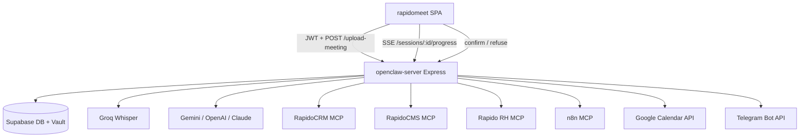
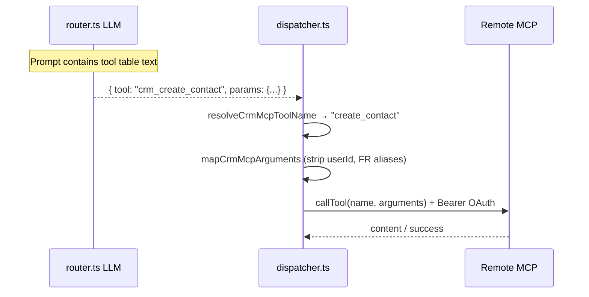

# Architecture & code map

This document describes how **openclaw-server** processes a meeting and where each concern lives in the codebase.

## System context



The frontend never calls MCP servers directly. Only this backend holds OAuth tokens and MCP clients.

---

## End-to-end pipeline

Triggered by `POST /upload-meeting` in `src/index.ts` (multer audio + fields).

| Step | Module | What happens |
|------|--------|----------------|
| 0 | `middleware/auth.ts` | Verify Supabase JWT (or `BYPASS_AUTH` in dev) |
| 1 | `utils/KeyResolver.ts` | Resolve per-user API keys (STT, orchestrator, n8n) from `user_connections` + env |
| 2 | `session.ts` | Create session (`sess_…`), persist to Redis/memory |
| 3 | `transcribe.ts` | Groq transcription; large files may be split (`utils/splitAudio.ts`) |
| 4 | `skill-loader.ts` | Pick skill by `meeting_type` or keyword detect |
| 5 | `extract.ts` | LLM #1 → summary, tasks, decisions, prospects (`INLPOutput`) |
| 6 | `router.ts` | LLM #2 → ordered `IAction[]` with `tool` + `params` + `requiresConfirmation` |
| 7 | `dispatcher.ts` | Run non-critical actions; queue critical ones as pending |
| 8 | `integrations/persistMeetingResults.ts` | Sync meeting / transcript / tasks to Supabase |
| 9 | `progress/ProgressBus.ts` + SSE | Live UI updates |

### Confirmation gate

Critical tools (`crm_create_*`, `cms_create_*`, `rh_*` writes, `calendar_create_event`, …) get `requiresConfirmation: true` (enforced in `config/services.ts` via `requiresConfirmationForTool`).

While pending:

- Rows in `pending_actions` (via `memory` / Connections patterns)
- Optional Telegram notify (`integrations/TelegramClient.ts`)
- Frontend approves via `POST /sessions/:id/actions/:actionId/confirm` (`routes/sessions.ts`)

On confirm, CRM / CMS / RH / Calendar actions execute **directly** through the dispatcher (no n8n hop).

---

## How the LLM “knows” MCP tools

**The model does not speak MCP protocol.** There is no runtime `listTools()` into the LLM context.

1. **Router prompt** (`router.ts` → `buildSystemPrompt`) embeds markdown tables from:
   - `config/crmTools.ts` → `buildCrmToolsPromptTable()`
   - `config/cmsTools.ts` → `buildCmsToolsPromptTable()`
   - `config/rhTools.ts` → `buildRhToolsPromptTable()`
2. Plus **skill markdown** (`skills/*.md`) and **extraction JSON**.
3. Model returns JSON actions; Zod validates tool names (`interfaces/MCPTool.ts`).
4. **Dispatcher** maps internal ids → remote MCP names and calls `client.callTool()`.



### Tool name maps (TypeScript, not JSON schemas for the model)

| File | Purpose |
|------|---------|
| `config/crmMcpToolMap.ts` | `crm_create_contact` → `create_contact` + arg shaping |
| `config/cmsMcpToolMap.ts` | 38 CMS tools (from live discovery) |
| `config/rhMcpToolMap.ts` | Seed RH map; refresh with `npm run list-rh-tools` |
| `config/cmsMcpTools.snapshot.json` | Optional dump from discovery script |

Refresh maps:

```bash
npm run list-crm-tools   # needs CRM OAuth / token
npm run list-cms-tools   # CMS_USER_ID or RAPIDOCMS_ACCESS_TOKEN
npm run list-rh-tools    # RH_USER_ID or RAPIDORH_ACCESS_TOKEN; needs /mcp on RH host
```

---

## HTTP API (main)

| Method | Path | Auth | Role |
|--------|------|------|------|
| GET | `/health` | — | Liveness |
| POST | `/upload-meeting` | JWT | Full pipeline |
| GET | `/sessions/:id` | JWT | Session + pending actions |
| GET | `/sessions/:id/progress` | JWT / query token | SSE progress |
| POST | `/sessions/:id/actions/:actionId/confirm` | JWT | Approve critical action |
| POST | `/sessions/:id/actions/:actionId/refuse` | JWT | Refuse |
| POST | `/sessions/:id/cancel` | JWT | Cancel pipeline |
| * | `/auth/crm/*` | mix | RapidoCRM OAuth |
| * | `/auth/cms/*` | mix | RapidoCMS OAuth |
| * | `/auth/rh/*` | mix | Rapido RH OAuth |
| * | `/auth/google/*` | mix | Google Calendar OAuth |
| * | `/auth/telegram/*` | JWT | Per-user Telegram bot |
| * | `/internal/*` | internal secret | Token broker for OpenClaw |

OAuth callbacks are **backend** URLs (`RAPIDO*_REDIRECT_URI`). After success, browsers redirect to `{FRONTEND_URL}/settings/integrations`.

---

## Auth & secrets

| Concern | Location |
|---------|----------|
| JWT verify | `middleware/auth.ts` |
| CORS | `config/cors.ts` + `CORS_ORIGIN` |
| Encrypted OAuth tokens | `integrations/ConnectionsStore.ts` + `credentialCrypto.ts` |
| Provider configs | `auth/*OAuthConfig.ts` |
| Shared Rapido OAuth router | `auth/createRapidoOAuthRouter.ts` |

`ConnectionsStore` resolves `getCRMConnection` / `getCMSConnection` / `getRHConnection` → `{ accessToken, mcpUrl }` with refresh when near expiry.

---

## Code map by directory

### Core pipeline (`src/`)

| File | Responsibility |
|------|----------------|
| `index.ts` | Express bootstrap, `/upload-meeting`, mounts routers |
| `transcribe.ts` | STT (Groq); `LOCAL_WHISPER_CONFIG.enabled` gates localhost Whisper |
| `extract.ts` | Structured NLP extraction (Zod schemas) |
| `router.ts` | Intent → `IAction[]` |
| `dispatcher.ts` | MCP / Calendar / DB / Telegram execution + retries |
| `session.ts` | Session CRUD (Redis or in-memory) |
| `memory.ts` | Tasks / pending_actions helpers |
| `skill-loader.ts` | Load & detect skills |

### Config (`src/config/`)

| File | Responsibility |
|------|----------------|
| `services.ts` | Groq/Gemini/retry/circuit breaker; critical-tool policy |
| `crmTools.ts` / `cmsTools.ts` / `rhTools.ts` | Tool helpers + prompt tables |
| `*McpToolMap.ts` | Internal → remote MCP name + arg mapping |
| `cors.ts` | Allowed origins |

### Auth (`src/auth/`)

Per-product OAuth (PKCE where applicable): CRM, CMS, RH, Google Calendar, Telegram bot connect.

### Integrations (`src/integrations/`)

| File | Responsibility |
|------|----------------|
| `ConnectionsStore.ts` | `user_connections` + vault credentials |
| `GoogleCalendarClient.ts` | Create events with user OAuth |
| `TelegramClient.ts` | Plain `sendMessage` confirmations |
| `persistMeetingResults.ts` | Sync session → meetings / transcriptions / tasks |
| `confirmationPreferences.ts` | In-app vs Telegram preference |

### Other

| Path | Responsibility |
|------|----------------|
| `routes/sessions.ts` | Session HTTP API + confirmation gate |
| `progress/` | Event bus + SSE |
| `resilience/CircuitBreaker.ts` | Protect flaky external APIs |
| `internal/` | OpenClaw token broker (optional WS path) |
| `interfaces/` | Shared TypeScript contracts (`IAction`, `INLPOutput`, …) |
| `skills/` | Domain prompt files |
| `.bin/` | Discovery & smoke scripts |

---

## Transcription policy notes

- Prefer **API STT only** when local Whisper is not hosted: set `LOCAL_WHISPER_CONFIG.enabled = false` in `config/services.ts`.
- `GROQ_CONFIG.maxFileSize` must align with Groq’s real limit (~25MB). An early size check that throws **before** `splitAudioIfNeeded` will reject mid-size files even when chunking exists.
- `utils/splitAudio.ts` currently splits only above its own threshold (see file); keep it consistent with `GROQ_CONFIG.maxFileSize`.

---

## Skills

Markdown files under `skills/` with front-matter. Examples: `commercial.md`, `tech.md`, `onboarding.md`, `phone_call.md`, `general.md`.

Used by:

- extraction system prompt
- routing user prompt (`Active Skill Instructions`)

---

## Related frontend

`rapidomeet` calls this API when `VITE_EXPRESS_API_BASE_URL` is set (`src/lib/expressApi.ts`, `useMeetingUpload.ts`). Otherwise it falls back to Edge Function `transcribe-audio`.

---

## Optional OpenClaw WS

`openclaw/OpenClawClient.ts` + `USE_OPENCLAW` / `OPENCLAW_WS_*` env vars. The primary execution path today is **in-process dispatcher → MCP/API**, not OpenClaw. See `OPENCLAW_MCP_INTEGRATION.md` for the older orchestration notes.
